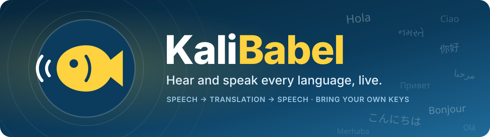
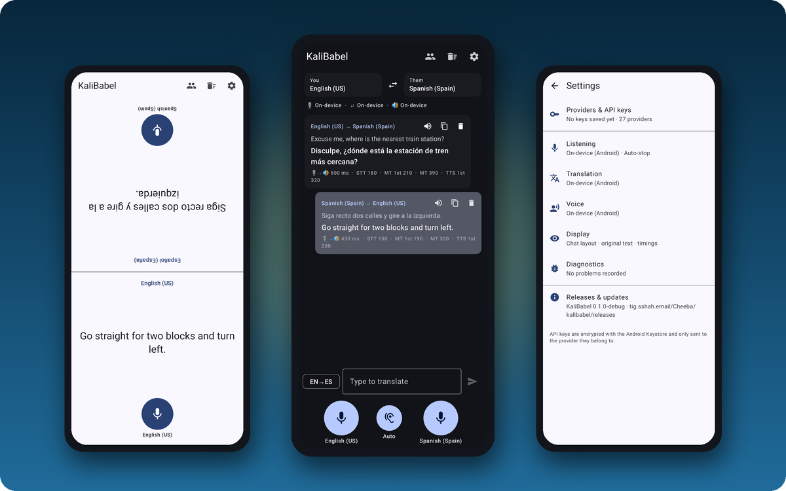
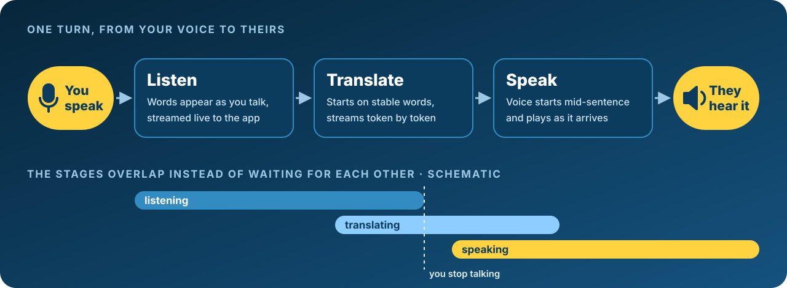
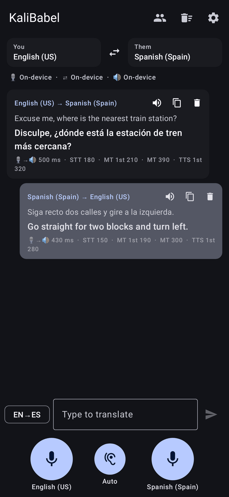
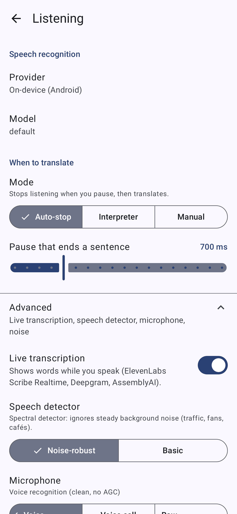
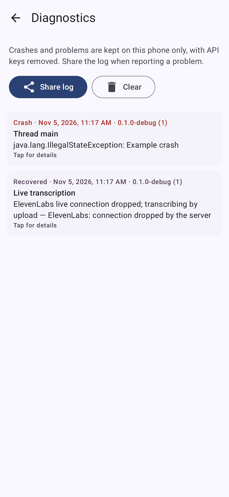
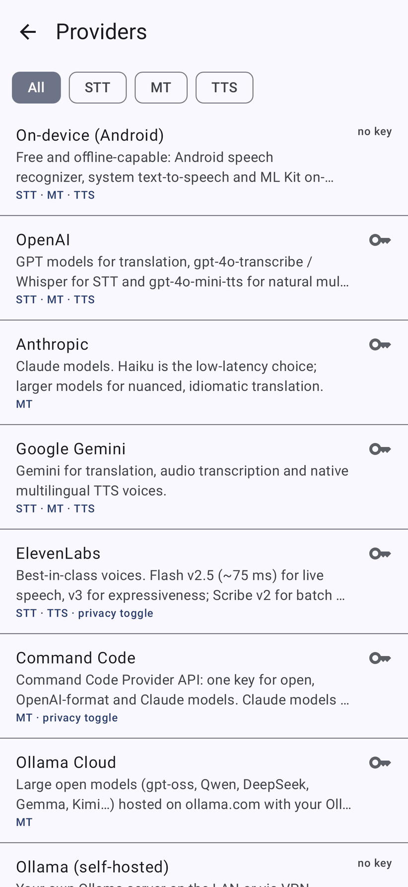
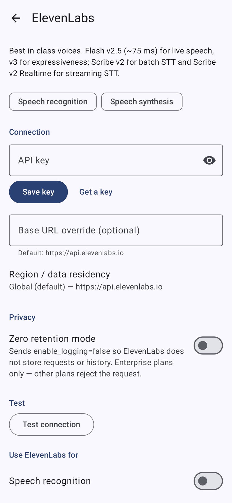

<p align="center">
  
</p>

<p align="center">
  <a href="https://github.com/sshahs/kalibabel/releases/latest"></a>
  <a href="https://github.com/sshahs/kalibabel/actions/workflows/android.yml"></a>
  <a href="https://github.com/sshahs/kalibabel/releases"></a>
  
  
  
  
</p>

<p align="center">
  <a href="#download"><b>Download</b></a> ·
  <a href="#quick-start">Quick start</a> ·
  <a href="#how-a-turn-flows">How it works</a> ·
  <a href="#providers">Providers</a> ·
  <a href="#screenshots">Screenshots</a> ·
  <a href="#building-from-source">Build</a> ·
  <a href="#roadmap">Roadmap</a>
</p>

> *"The Babel fish is small, yellow, leech-like, and probably the oddest thing in the Universe…
> if you stick one in your ear, you can instantly understand anything said to you in any form of language."*
> — Douglas Adams, *The Hitchhiker's Guide to the Galaxy*

**KaliBabel is a Babel fish for your phone.** You speak; it listens, translates and says it out loud
in the other person's language, and they answer the same way. Everything is tuned to shrink the gap
between the end of your sentence and the first translated word. Bring your own API keys and pick a
provider for each stage, or use the free on-device stack, which works out of the box with no key at all.

<p align="center">
  
</p>
<p align="center"><sub>Screens rendered by the app's UI tests, with sample conversation data.</sub></p>

## Highlights

<table>
<tr>
<td width="33%" valign="top">

### ⚡ Built for speed
Live speech recognition, translation that starts **before you finish talking**, and a voice that
starts **before the translation is done**. Every message shows its mouth-to-ear time.

</td>
<td width="33%" valign="top">

### 🎙️ Three mics, three modes
A mic for each language plus **Auto** (detects who's speaking). Auto-stop, continuous
**Interpreter** mode or Manual, and a **face-to-face** split screen for the person opposite.

</td>
<td width="33%" valign="top">

### 🌍 27 providers, your keys
OpenAI, Anthropic, Gemini, ElevenLabs, Deepgram, Ollama Cloud, Command Code, DeepL, Groq and more,
each with live **model and voice pickers**. Mix a different provider for every stage.

</td>
</tr>
<tr>
<td width="33%" valign="top">

### 🛟 Doesn't drop your words
A dropped live transcription is finished by upload; a dropped voice stream picks up at the word it
stopped on; a failing provider falls back to on-device.

</td>
<td width="33%" valign="top">

### 🔐 Private by design
Keys are encrypted in the **Android Keystore** and never backed up. History stays on the phone.
Zero-retention switches for Command Code, OpenRouter, ElevenLabs and Deepgram.

</td>
<td width="33%" valign="top">

### 📴 Works with no key
On-device speech recognition, **ML Kit** translation and the system voices out of the box.
Download language packs and it keeps working offline.

</td>
</tr>
</table>

## Download

Signed APKs are attached to every release, on **[Gitea](https://tig.sshah.email/Cheeba/kalibabel/releases)**
and on **[GitHub](https://github.com/sshahs/kalibabel/releases)**. Both are built from the same commit and
signed with the same key, so use whichever you like. Every push to `main` also publishes a
`build-<N>` prerelease if you want the newest build.

| File | Install on |
|---|---|
| `KaliBabel-<version>-arm64-v8a-release.apk` | **Almost every phone** from the last ~8 years |
| `KaliBabel-<version>-armeabi-v7a-release.apk` | Older 32-bit phones |
| `KaliBabel-<version>-x86_64-release.apk` | Emulators and Chromebooks |
| `KaliBabel-<version>-universal-release.apk` | Any device (larger download) |
| `SHA256SUMS.txt` | Checksums: `sha256sum -c SHA256SUMS.txt` |
| `KaliBabel-<version>-r8-mapping.txt.gz` | Not for installing: decodes crash reports from that release |

> [!TIP]
> Install with [Obtainium](https://github.com/ImranR98/Obtainium) pointed at either releases page to get
> updates automatically. The app also links to the releases page under **Settings → Releases & updates**.

## Quick start

1. **Install** the `arm64-v8a` APK and open KaliBabel.
2. **Pick the two languages** at the top (*You* and *Them*). The on-device stack is already set up, so
   you can tap a mic and talk straight away.
3. **For lower latency and better quality**, add API keys under **Settings → Providers & API keys**,
   then choose a provider for each stage under **Listening**, **Translation** and **Voice**.

**Good combinations to start from:**

| | Speech recognition | Translation | Voice |
|---|---|---|---|
| ⚡ **Lowest latency** | Deepgram Nova-3 or ElevenLabs Scribe Realtime | Groq, Cerebras or Claude Haiku | ElevenLabs Flash v2.5 or Cartesia Sonic |
| 🎯 **Accuracy first** | ElevenLabs Scribe v2 (batch) | A larger Claude, Gemini or GPT model | ElevenLabs Multilingual v2 |
| 🔒 **Most private** | On-device | On-device, or an LLM through Command Code or OpenRouter with ZDR on | On-device |
| 💸 **Free, no key** | On-device | On-device (ML Kit) | On-device |

## How a turn flows

<p align="center">
  
</p>

Each stage overlaps the next: translation starts before you've finished, and the voice starts while the
translation is still being written.

### How the latency is kept down

1. **Realtime STT when available.** Audio streams over a WebSocket while you speak, so the final
   transcript arrives within a few hundred milliseconds of you stopping. With batch STT, a local voice
   activity detector (VAD) cuts the utterance the moment you pause, and it uploads as raw 16 kHz PCM.
   The default **noise-robust detector** looks at the speech band of an FFT spectrum against a tracked
   noise profile, so steady background noise (traffic, fans, cafés) doesn't keep it stuck "listening".
   *Settings → Listening → Advanced → Speech detector* switches back to the basic volume-based one.
2. **Translating before you finish.** Once your words stop changing on screen, translation starts
   while the recogniser is still confirming the end of the sentence. If the final transcript matches
   (ignoring case and punctuation), the translation is already under way. Messages that benefited show
   *⚡ early MT*. There are at most 3 speculative requests per utterance; turn this off under
   *Settings → Translation → Advanced*.
3. **Pre-warming.** When you tap a mic, the app opens TLS/HTTP-2 connections to the translation and
   TTS providers (and loads the model on self-hosted Ollama), so those requests start hot.
4. **Streaming translation.** Tokens are shown as they arrive and cut into speakable chunks. With
   *Start speaking early* on, the first chunk can end at a clause boundary.
5. **Speaking starts before the translation is finished.** With ElevenLabs (Flash, Turbo or
   Multilingual v2), the translation is streamed into the voice **word by word** over its `stream-input`
   WebSocket, which is opened as soon as the turn starts. With other providers, TTS for chunk 1 runs while
   the LLM is still writing chunk 2. Either way, audio is streamed as PCM straight into a low-latency
   `AudioTrack`, with no file or decoder in between.
6. **Parallel turns, ordered playback.** Several turns can be in flight at once, but they're always
   spoken in conversation order. Tapping a mic interrupts playback (barge-in).
7. **Thinking is turned off** for models where it can be: Gemini thinking budget 0, Ollama
   `think: false`. Parameters a model rejects (for example `temperature` on reasoning models) are
   remembered and dropped automatically after the first error.

### When things go wrong

- **A cloud provider fails** (no signal, rate limit): the turn falls back to on-device translation and
  the system voice.
- **The live transcription connection drops:** nothing you said is lost. The speech it hadn't
  confirmed yet is transcribed by upload (or, failing that, the live text so far is kept), and in
  Interpreter mode listening carries on that way.
- **The ElevenLabs voice stream drops mid-reply:** the rest of the reply is spoken sentence by
  sentence, starting from the word where it stopped.
- **Settings → Diagnostics** keeps an on-device log of crashes and of what failed or was worked
  around, with API keys removed. Share it from there; after a crash, the app offers it on the next
  launch.

## Features

- **Three mics.** One for each person's language, plus an **Auto** mic that detects which of the two
  languages is being spoken (from STT language detection, then on-device ML Kit language ID, then an
  LLM fallback that tags its reply with the language).
- **Listening modes:** **Auto-stop** (stops when you pause), **Interpreter** (keeps listening and
  translates sentence by sentence) and **Manual** (records until you tap, then translates everything
  at once).
- **Face-to-face layout.** The screen splits in two, with the top half rotated 180° for the person opposite.
- **A provider for every stage.** Each has a live **model picker** (fetched from the provider's API,
  searchable, with custom IDs allowed) and a **voice picker** for each language.
- **Accuracy:**
  - The interpreter prompt is tuned for speech transcripts and refuses to answer questions, so it never
    replies to "what time is it?"
  - Recent conversation context is sent with each request
  - Formal or informal register
  - A glossary that also biases speech recognition (Deepgram keyterms, ElevenLabs keyterms, AssemblyAI
    keyterms_prompt, Whisper prompt)
  - Free-form extra instructions
- **A latency breakdown on every message:** mouth-to-ear time, STT, time to first token, translation
  total and time to first audio.
- Text input, **"Translate with KaliBabel"** in the system text-selection menu, and the share sheet.
- Replay, copy and delete for each message. History is stored locally only.
- **Keys are encrypted** with an AES-256-GCM key held in the Android Keystore. The app is excluded from
  cloud backup and device transfer. Each key is only sent to the provider it belongs to.

## Providers

| Provider | STT | Translation | TTS | Notes |
|---|:-:|:-:|:-:|---|
| **On-device (Android)** | ✅ live partials | ✅ ML Kit, offline | ✅ system TTS engines | No key. Language packs can be downloaded for offline use |
| **OpenAI** | ✅ gpt-4o(-mini)-transcribe, whisper-1 | ✅ | ✅ gpt-4o-mini-tts, streams PCM | |
| **Anthropic** | | ✅ Claude (Haiku default) | | |
| **Google Gemini** | ✅ audio understanding | ✅ thinking disabled for latency | ✅ native TTS, 30 voices | |
| **ElevenLabs** | ✅ Scribe v2 batch + **Scribe v2 Realtime** (WebSocket) | | ✅ Flash v2.5 / Turbo / Multilingual / v3, streams PCM | Live model and voice catalogs, data-residency region, **zero-retention toggle** (`enable_logging=false`, Enterprise only) |
| **Command Code** | | ✅ open, OpenAI-format and Claude models | | Claude models are routed to `/messages` automatically. **ZDR toggle** (`x-cmd-zdr: 1`) |
| **Ollama Cloud** | | ✅ `ollama.com/api/chat` | | Native API, thinking disabled |
| **Ollama (self-hosted)** | | ✅ | | Model is preloaded and kept warm (`keep_alive`) |
| **DeepL** | | ✅ latency- or quality-optimized | | Free and Pro keys detected automatically. Sends context and formality |
| **Deepgram** | ✅ Nova-3 realtime + batch | | ✅ Aura-2, voice per language | **MIP opt-out toggle** |
| **AssemblyAI** | ✅ Universal-Streaming v3 + batch | | | EU region |
| **Cartesia** | ✅ Ink-Whisper | | ✅ Sonic 3, streams PCM | |
| **Groq** | ✅ Whisper large-v3-turbo (very fast) | ✅ | ✅ Orpheus | |
| **Cerebras** | | ✅ (very high token rate) | | |
| **Mistral** | ✅ Voxtral | ✅ | | |
| **Cohere** | | ✅ Command A Translate | | |
| **OpenRouter** | | ✅ hundreds of models | | **ZDR toggle** (`provider.zdr`, `data_collection: deny`) |
| **Together AI** | ✅ Whisper | ✅ | ✅ | |
| DeepSeek, xAI, Fireworks, SambaNova, Moonshot (Kimi), Qwen (DashScope), Z.ai (GLM), Hugging Face | | ✅ | | OpenAI-compatible presets |
| **Custom OpenAI-compatible** | ✅ | ✅ | ✅ | LM Studio, vLLM, LiteLLM, LocalAI, Speaches, Kokoro-FastAPI… |

## Screenshots

<table>
<tr>
<td align="center"><br><sub>Conversation</sub></td>
<td align="center"><br><sub>Dark theme</sub></td>
<td align="center"><br><sub>Face-to-face</sub></td>
</tr>
<tr>
<td align="center"><br><sub>Settings</sub></td>
<td align="center"><br><sub>Listening, Advanced open</sub></td>
<td align="center"><br><sub>Diagnostics</sub></td>
</tr>
<tr>
<td align="center"><br><sub>Providers & API keys</sub></td>
<td align="center"><br><sub>ElevenLabs</sub></td>
<td align="center"><br><sub>Command Code ZDR</sub></td>
</tr>
</table>

## Building from source

Requirements: JDK 17 or newer (21 recommended) and an Android SDK with `platforms;android-37.0` and
`build-tools;36.0.0`.

```bash
./gradlew testDebugUnitTest lintDebug assembleDebug
# APKs: app/build/outputs/apk/debug/app-arm64-v8a-debug.apk (and other ABIs + universal)
```

Stack: Kotlin 2.4, AGP 9.5 (built-in Kotlin), Gradle 9.8, Jetpack Compose with Material 3, OkHttp 5,
kotlinx.serialization and coroutines, ML Kit (on-device translation and language ID). minSdk 26,
targetSdk 36. ML Kit's offline translator adds about 16 MB of native code per ABI, so the build
splits APKs by ABI.

**Signed release builds.** Set `KALIBABEL_KEYSTORE_FILE`, `KALIBABEL_KEYSTORE_PASSWORD`,
`KALIBABEL_KEY_ALIAS` and `KALIBABEL_KEY_PASSWORD`, or create a git-ignored `keystore.properties`
containing `storeFile`, `storePassword`, `keyAlias` and `keyPassword`. Without these, release builds
are signed with the debug key.

**README images.** The screenshots and the hero image come from the Robolectric UI render tests:

```bash
./gradlew testDebugUnitTest --tests '*ScreensRenderTest'   # writes app/build/screenshots/
python3 scripts/docs/readme-images.py                       # docs/assets/hero.png + docs/screenshots/
```

### Project layout

```
app/src/main/java/email/sshah/kalibabel/
├── audio/        AudioRecorder (16 kHz frames), Vad, AudioPlayer + ordered SpeechQueue, WAV helpers
├── data/         AppSettings, SettingsRepository, SecureKeyStore (Keystore AES-GCM),
│                 Languages, HistoryStore, ErrorLog (on-device crash/failure log)
├── net/          OkHttp helpers: SSE/NDJSON/byte streaming, WebSockets, error extraction
├── pipeline/     Interpreter (orchestration + metrics), LiveTranscription (drop-proof streaming STT),
│                 SentenceChunker, LangTagParser, Prompts
├── providers/    Engine interfaces, ProviderSpecs (catalogue), ProviderRegistry
│   └── impl/     One class per API family (OpenAI-compatible, Anthropic, Gemini, ElevenLabs, Deepgram, …)
└── ui/           Compose screens: conversation, settings, providers, pickers
```

**Adding a provider:** add a `ProviderSpec` (and an enum entry). If it speaks the OpenAI dialect, you're
done. Otherwise implement a `Provider` subclass that exposes `translation`, `stt` and/or `tts`, then
map it in `ProviderRegistry.create`.

<details>
<summary><b>CI, releases and signing</b> (for maintainers)</summary>

### Two workflows, one set of scripts

There are two workflows that do the same job using the same scripts in `scripts/ci/`:

- `.gitea/workflows/android.yml` runs on the Gitea mirror for **every tag a sync brings from GitHub**,
  and publishes the matching **Gitea release**: a prerelease for `build-<N>` (every push to `main`), and
  a full release for `v*`. That's one run per update, and every run ends in a release. Plain branch
  syncs aren't built on their own, because the commit's `build-<N>` tag follows and builds it.
- `.github/workflows/android.yml` runs on GitHub for every push and pull request. Every push to `main`
  is published as a **prerelease `build-<N>`**, so the newest build is always downloadable. Official
  `v*` releases are a deliberate step (below). After publishing, GitHub asks Gitea to sync straight
  away if the `GITEA_SYNC_TOKEN` secret is set. Without it, the mirror interval picks the tag up.

Each forge only reads its own folder. `versionCode` is the number of commits on `HEAD`, so a build of
a given commit gets the same code on both forges, and newer builds can always update older installs.
Each run:

1. installs JDK 21 and the Android SDK (`scripts/ci/setup-android-sdk.sh`; Gradle and the SDK are
   cached with `actions/cache`)
2. runs the unit tests and the Robolectric UI render tests (screenshots are uploaded with the reports).
   Robolectric's Android runtime jar is resolved through Gradle and cached with it, so tests run offline.
   CI downloads Maven Central artifacts through Google's mirror (`KALIBABEL_MAVEN_MIRROR`), because
   Maven Central rate-limits busy or self-hosted runner IPs (HTTP 429)
3. runs lint
4. builds debug and release APKs and uploads them as the `kalibabel-apks` artifact

### Publishing a release

`https://tig.sshah.email/Cheeba/kalibabel` is a pull mirror of GitHub, so releases start from a
**tag on GitHub**. There are two ways to create one:

- **From the browser:** go to GitHub → *Actions → Android CI → Run workflow*, keep the branch as `main`,
  and enter a release tag such as `v0.2.0`. The run builds, tests and signs first. Only if all of that
  passes does it push the tag (as `github-actions[bot]`) and publish the GitHub release. If anything
  fails, no tag is created.
- **From the command line:**

  ```bash
  git tag -a v0.2.0 -m "KaliBabel 0.2.0"
  git push origin v0.2.0
  ```

The steps below describe what happens on the Gitea mirror once the tag exists.

1. The Gitea mirror picks up the tag on its **next scheduled sync**. Nothing needs doing by hand: the
   release appears on Gitea on its own, just like KaliScriber's. How soon depends on the mirror
   interval (*Settings → Repository → Mirror settings → Interval*; Gitea's default is 8 hours, and
   something like `10m` makes releases show up within minutes). *Synchronize now* is only a shortcut.
2. The sync fires a `push` event for the tag. The workflow builds and signs the APKs, then
   `scripts/ci/gitea-release.sh` turns the synced tag into a full release on the mirror repo. It
   attaches the per-ABI APKs, `SHA256SUMS.txt` and the R8 mapping, and adds release notes listing every commit since
   the previous tag.
3. The job log and summary link straight to the release page.

Tags containing `-` (for example `v1.0.0-beta1`) are published as prereleases. Re-running the job
replaces the existing assets instead of duplicating them.

Gitea releases only come from `v*` tags made on GitHub. Tags created on Gitea alone would be deleted
again by the next mirror sync, so Gitea builds of other commits are kept as run artifacts.

**Release notes:** by default, the notes list the commits since the previous `v*` release. To write
your own instead (like KaliScriber), add `.github/release-notes/vX.Y.Z.md` before cutting `vX.Y.Z`.
The install guide and links to the commit and the build are added automatically either way.

**Gitea-side requirements for releases:**

- **Gitea 1.21.5 or newer.** Older versions wipe all releases of pull mirrors on every sync.
- **The Actions and Releases units are enabled** on the mirror repo (repo *Settings → Repository*).
- **The Actions token can write releases.** The workflow requests `contents: write`, which is
  enough with the default permissive token mode (and in restricted mode on Gitea 1.26+).
  Otherwise, add a `RELEASE_TOKEN` secret with a personal token that has `write:repository`.
- **Uploads are allowed:** about 75 MB for the universal APK. Check `[repository.release] FILE_MAX_SIZE`
  and the reverse proxy body limit (for example nginx `client_max_body_size 200m`). If
  `[repository.release] ALLOWED_TYPES` is set, it must allow `.apk` and `.txt` (and `.gz` for the R8
  mapping, which is otherwise skipped with a warning).
- **Optional:** shorten the mirror interval (for example `10m`) so new commits and tags build
  sooner.

**Runner requirements:**

- An **x86_64** act_runner. Google only ships Linux build-tools (aapt2) for x86_64.
- The `ubuntu-latest` label must map to an image that includes Node. The default
  `docker://gitea/runner-images:ubuntu-latest` or `catthehacker/ubuntu:act-latest` both work.
- About 6 GB of RAM.
- Actions on the instance can resolve `actions/*` from GitHub (Gitea's default `DEFAULT_ACTIONS_URL`).

### Secrets and variables for APK releases

Set the same values in both places:

- **Gitea:** **Settings → Actions → Secrets / Variables**
  (https://tig.sshah.email/Cheeba/kalibabel/settings/actions/secrets)
- **GitHub:** **Settings → Secrets and variables → Actions**
  (https://github.com/sshahs/kalibabel/settings/secrets/actions)

`RELEASE_TOKEN` only applies to Gitea. GitHub uses its built-in token.

| Secret | Required | Value |
|---|---|---|
| `KEYSTORE_BASE64` | for `v*` tags | The release keystore, base64-encoded on one line |
| `KEYSTORE_PASSWORD` | for `v*` tags | The keystore password |
| `KEY_ALIAS` | for `v*` tags | The key alias (`kalibabel` if you use the script below) |
| `KEY_PASSWORD` | for `v*` tags | The key password. For PKCS12 keystores this is the same as `KEYSTORE_PASSWORD` |
| `RELEASE_TOKEN` | no | A personal access token with `write:repository`. Only needed if the automatic Actions token can't create releases on your instance |
| `GITEA_SYNC_TOKEN` (GitHub only) | no | A Gitea access token with `write:repository` on the mirror. GitHub uses it to make Gitea sync the moment a build or release is published, so Gitea's release follows within minutes with no manual sync |

| Variable | Default | Effect |
|---|---|---|
| `RELEASE_DRAFT` | unset | Set to `true` to publish releases as drafts, so you can review them before they go public |
| `GITEA_REPO_API` (GitHub only) | `https://tig.sshah.email/api/v1/repos/Cheeba/kalibabel` | The Gitea API URL of the mirror that `GITEA_SYNC_TOKEN` syncs |
| `ALLOW_DEBUG_SIGNED_RELEASE` | unset | Set to `true` to let tag builds run without signing secrets (testing only) |

**Creating the signing key and secrets.** Run this on your own machine (it needs a JDK), so the
private key never passes through CI logs or chat:

```bash
# Creates release-signing/kalibabel-release.jks (git-ignored) and uploads the four secrets.
# The token needs the write:repository scope: https://tig.sshah.email/user/settings/applications
GITEA_TOKEN=<your token> scripts/release-keystore.sh --upload

# Or, without a token: writes release-signing/gitea-secrets.txt for you to paste into the UI.
scripts/release-keystore.sh

# Already have a keystore? Reuse it:
scripts/release-keystore.sh --keystore path/to/existing.jks --upload
```

The script checks the alias and password before it uploads anything, then prints the certificate's
SHA-256 fingerprint. CI prints the same fingerprint in each release's notes, so users can verify
downloads.

**Back up the `.jks` file and its password** somewhere safe, such as a password manager plus an
offline copy. Android only installs an update over an existing install if it's signed with the same
key. If the key is lost, every user would have to uninstall and reinstall.

**Safeguards in CI** (`scripts/ci/decode-keystore.sh`, `scripts/ci/check-signing-cert.sh`):

- A `v*` tag build **fails** if the signing secrets are missing. A release signed with the debug key
  can never be upgraded to by a properly signed one.
- A wrong password or alias fails early with a clear error.
- Every APK is checked against the certificate fingerprint pinned in `.github/signing-cert-sha256`
  before anything is published. If either forge's `KEYSTORE_BASE64` ever held a different key, the
  release fails instead of shipping APKs that won't install as updates. If you ever change the
  signing key on purpose, update this file too.
- Builds of `main` without secrets still run, signed with the debug key.

Artifacts are uploaded with `actions/upload-artifact@v3`, because Gitea identifies itself as GHES,
which `@v4` rejects.

</details>

## Status and caveats

- The build, unit tests, UI render tests, lint and signed release packaging are all verified in CI.
  Each provider integration was written against that provider's current API documentation, but most
  **haven't been exercised with live API keys yet**. Expect a few to need tweaks once tried: request
  parameter names, newer model IDs, voice defaults. Use *Test connection* on each provider screen, and
  share the log from *Settings → Diagnostics* if something fails.
- The default model IDs are only starting points. Use the model picker to choose from what your key
  can actually access.
- The microphone stops when the app goes to the background. A foreground service is on the roadmap.

## Roadmap

**Latency**
- [x] **Speculative translation** of stable partial transcripts.
- [x] **Text-streaming TTS over WebSockets** for ElevenLabs. Cartesia and Deepgram WebSockets would be
  next.
- [ ] **Speech-to-speech realtime models** (OpenAI Realtime, Gemini Live) as a single-hop mode.
- [x] **A noise-robust speech detector** (spectral, pure Kotlin).
- [ ] **A neural VAD** (Silero via ONNX Runtime) for babble noise, such as other people talking. It
  would add about 6 MB per ABI.
- [ ] **Adaptive provider racing.** Send the request to two translation providers and use whichever
  answers first, or auto-pick based on measured p50 latency per network.

**Reliability**
- [x] **Live transcription that survives dropped connections** (finished by upload instead).
- [x] **Voice streams that resume** at the word where they stopped.
- [x] **An on-device crash and error log** you can share, with keys removed; R8 mappings on every release.
- [ ] **A provider self-test and benchmark screen** that checks every configured key and measures each
  stage's latency.
- [ ] **An emulator smoke test of the signed release APK in CI.**

**Accuracy**
- [ ] **Automatic language-pair suggestion** from detected speech, and per-contact or per-trip presets
  (for example "Taxi in Tokyo").
- [ ] **Glossary import/export, and DeepL glossary sync.**
- [ ] **Show alternatives or back-translation**, so you can check the meaning came through.
- [ ] **Speaker-aware voices.** Clone or select a voice so each person's translation sounds like them
  (ElevenLabs voice cloning).

**Use cases**
- [ ] **Foreground service** with a notification control, so interpreter mode keeps working with the
  screen off.
- [ ] **Earbud mode.** You hear translations in Bluetooth earbuds while the other person hears your
  translation from the phone speaker. This needs audio routing per output.
- [ ] **Listen-only mode** for lectures, announcements and TV, with a live subtitle view and transcript
  export.
- [ ] **Camera/OCR translation** of signs and menus (ML Kit text recognition, then the same pipeline).
- [ ] **Phrasebook and offline packs** for common travel phrases.
- [ ] **A Wear OS tile or Quick Settings tile** to start the interpreter with one tap.
- [ ] **Usage and cost tracking** per provider, using the token and character counts the APIs return.

**Privacy**
- [ ] **A "Private mode" preset** that turns on every ZDR and opt-out toggle and refuses providers
  without one.
- [ ] **Encrypted history**, with automatic deletion after N days.
- [ ] **An optional "lite" build flavour without ML Kit**, about 5 MB instead of about 20 MB.

---

<p align="center">
  <sub><b>Don't Panic.</b> 🐟 Named after the Babel fish from Douglas Adams' <i>The Hitchhiker's Guide to the Galaxy</i>.</sub>
</p>
