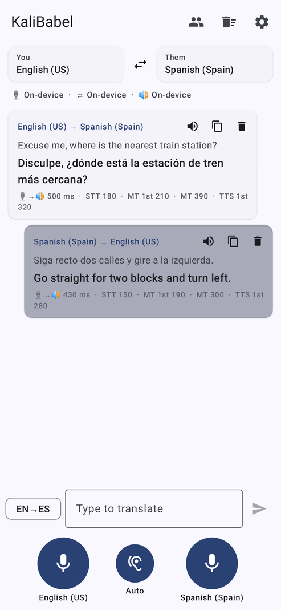
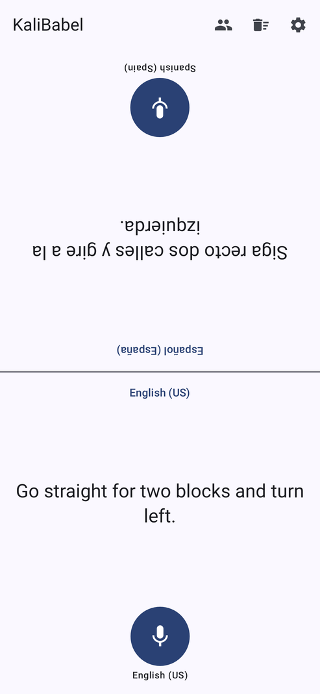
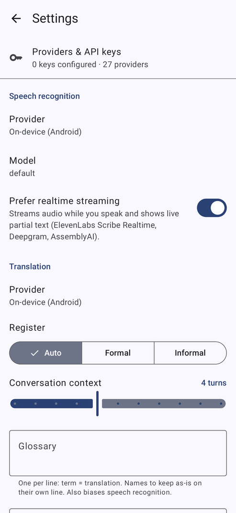
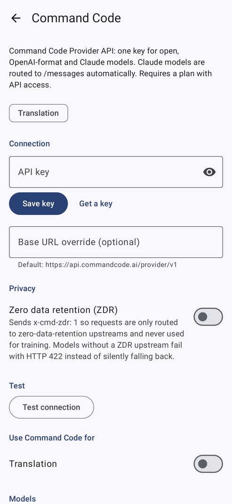

# KaliBabel

> *"The Babel fish is small, yellow, leech-like, and probably the oddest thing in the Universe…
> if you stick one in your ear, you can instantly understand anything said to you in any form of language."*

KaliBabel is an Android live interpreter. You speak, it listens (STT), translates and speaks the
translation aloud (TTS), aiming to keep the delay from the end of your sentence to the first
translated word as short as possible. It's bring-your-own-key: you pick a provider for each stage,
mixing cloud and on-device engines. The free on-device stack works out of the box with no key.

<p>




</p>

*(Screenshots are rendered by the Robolectric UI tests in CI.)*

## Features

- **Three mics.** One for each person's language, plus an **Auto** mic that detects which of the two
  languages is being spoken (from STT language detection, then on-device ML Kit language ID, then an
  LLM fallback that tags its reply with the language).
- **Listening modes.**
  - **Auto-stop** (stops when you pause)
  - **Interpreter** (keeps listening and translates sentence by sentence)
  - **Manual** (records until you tap, then translates everything at once)
- **Face-to-face layout.** The screen splits in two, with the top half rotated 180° for the person opposite.
- **Every stage can use a different provider.** Each one has a live **model picker** (fetched from the
  provider's API, searchable, with custom IDs allowed) and a **voice picker** for each language.
- **Accuracy features:**
  - The interpreter prompt is tuned for speech transcripts and refuses to answer questions, so it never
    replies to "what time is it?"
  - Recent conversation context is sent with each request
  - Formal or informal register
  - A glossary that also biases speech recognition (Deepgram keyterms, ElevenLabs keyterms, AssemblyAI
    keyterms_prompt, Whisper prompt)
  - Free-form extra instructions
- **Resilience.** If a cloud provider fails (no signal, rate limit), the turn falls back to on-device
  translation and the system voice.
- **Latency breakdown on every message:** mouth-to-ear time, STT, time to first token, translation
  total, and time to first audio.
- Text input, **"Translate with KaliBabel"** in the system text-selection menu, and the share sheet.
- Replay, copy and delete for each message. History is stored locally only.
- **Keys are encrypted** with an AES-256-GCM key held in the Android Keystore. The app is excluded from
  cloud backup and device transfer. Each key is only sent to the provider it belongs to.

## Providers

| Provider | STT | Translation | TTS | Notes |
|---|:-:|:-:|:-:|---|
| **On-device (Android)** | ✅ live partials | ✅ ML Kit, offline | ✅ system TTS engines | No key. Language packs can be downloaded for offline use |
| **OpenAI** | ✅ gpt-4o(-mini)-transcribe, whisper-1 | ✅ | ✅ gpt-4o-mini-tts, streams PCM | |
| **Anthropic** | | ✅ Claude (Haiku default) | | |
| **Google Gemini** | ✅ audio understanding | ✅ thinking disabled for latency | ✅ native TTS, 30 voices | |
| **ElevenLabs** | ✅ Scribe v2 batch + **Scribe v2 Realtime** (WebSocket) | | ✅ Flash v2.5 / Turbo / Multilingual / v3, streams PCM | Live model and voice catalogs, data-residency region, **zero-retention toggle** (`enable_logging=false`, Enterprise only) |
| **Command Code** | | ✅ open, OpenAI-format and Claude models | | Claude models are routed to `/messages` automatically. **ZDR toggle** (`x-cmd-zdr: 1`) |
| **Ollama Cloud** | | ✅ `ollama.com/api/chat` | | Native API, thinking disabled |
| **Ollama (self-hosted)** | | ✅ | | Model is preloaded and kept warm (`keep_alive`) |
| **DeepL** | | ✅ latency- or quality-optimized | | Free and Pro keys detected automatically. Sends context and formality |
| **Deepgram** | ✅ Nova-3 realtime + batch | | ✅ Aura-2, voice per language | **MIP opt-out toggle** |
| **AssemblyAI** | ✅ Universal-Streaming v3 + batch | | | EU region |
| **Cartesia** | ✅ Ink-Whisper | | ✅ Sonic 3, streams PCM | |
| **Groq** | ✅ Whisper large-v3-turbo (very fast) | ✅ | ✅ Orpheus | |
| **Cerebras** | | ✅ (very high token rate) | | |
| **Mistral** | ✅ Voxtral | ✅ | | |
| **Cohere** | | ✅ Command A Translate | | |
| **OpenRouter** | | ✅ hundreds of models | | **ZDR toggle** (`provider.zdr`, `data_collection: deny`) |
| **Together AI** | ✅ Whisper | ✅ | ✅ | |
| DeepSeek, xAI, Fireworks, SambaNova, Moonshot (Kimi), Qwen (DashScope), Z.ai (GLM), Hugging Face | | ✅ | | OpenAI-compatible presets |
| **Custom OpenAI-compatible** | ✅ | ✅ | ✅ | LM Studio, vLLM, LiteLLM, LocalAI, Speaches, Kokoro-FastAPI… |

## How the latency is kept down

1. **Realtime STT when available.** Audio streams over a WebSocket while you speak, so the final
   transcript arrives within a few hundred milliseconds of you stopping. With batch STT, a local voice
   activity detector (VAD) cuts the utterance the moment you pause, and it uploads as raw 16 kHz PCM.
2. **Pre-warming.** When you tap a mic, the app opens TLS/HTTP-2 connections to the translation and
   TTS providers (and loads the model on self-hosted Ollama), so those requests start hot.
3. **Streaming translation.** Tokens are shown as they arrive and cut into speakable chunks. With
   *Start speaking early* on, the first chunk can end at a clause boundary.
4. **Speaking starts before the translation is finished.** TTS for chunk 1 runs while the LLM is still
   writing chunk 2. Audio is streamed as PCM straight into a low-latency `AudioTrack`, with no file or
   decoder in between.
5. **Parallel turns, ordered playback.** Several turns can be in flight at once, but they're always
   spoken in conversation order. Tapping a mic interrupts playback (barge-in).
6. **Thinking is turned off** for models where it can be: Gemini thinking budget 0, Ollama
   `think: false`. Parameters a model rejects (for example `temperature` on reasoning models) are
   remembered and dropped automatically after the first error.

For the lowest latency, a good starting combination is **Deepgram Nova-3 or ElevenLabs Scribe
Realtime → Groq, Cerebras or Claude Haiku → ElevenLabs Flash v2.5 or Cartesia Sonic**. If you need
privacy, use the on-device stack, or turn on Command Code ZDR or OpenRouter ZDR.

## Building

Requirements: JDK 17 or newer (21 recommended) and an Android SDK with `platforms;android-37.0` and
`build-tools;36.0.0`.

```bash
./gradlew testDebugUnitTest lintDebug assembleDebug
# APKs: app/build/outputs/apk/debug/app-arm64-v8a-debug.apk (and other ABIs + universal)
```

Stack: Kotlin 2.4, AGP 9.5 (built-in Kotlin), Gradle 9.8, Jetpack Compose with Material 3, OkHttp 5,
kotlinx.serialization and coroutines, ML Kit (on-device translation and language ID). minSdk 26,
targetSdk 36. ML Kit's offline translator adds about 16 MB of native code per ABI, so the build
splits APKs by ABI. Install the `arm64-v8a` APK on modern phones.

**Signed release builds.** Set `KALIBABEL_KEYSTORE_FILE`, `KALIBABEL_KEYSTORE_PASSWORD`,
`KALIBABEL_KEY_ALIAS` and `KALIBABEL_KEY_PASSWORD`, or create a git-ignored `keystore.properties`
containing `storeFile`, `storePassword`, `keyAlias` and `keyPassword`. Without these, release builds
are signed with the debug key.

## CI: Gitea Actions (act_runner)

The workflow is `.gitea/workflows/android.yml`. GitHub ignores `.gitea/`, so it only runs on the Gitea
mirror (`tig.sshah.email`). On every push and pull request it:

1. installs JDK 21 and the Android SDK (`scripts/ci/setup-android-sdk.sh`; Gradle and the SDK are
   cached with `actions/cache`)
2. runs the unit tests and the Robolectric UI render tests (screenshots are uploaded with the reports)
3. runs lint
4. builds debug and release APKs and uploads them as the `kalibabel-apks` artifact

**Pushing a tag `v1.2.3`** also creates a Gitea release and attaches the per-ABI release APKs to it
(`scripts/ci/gitea-release.sh`). Tags containing `-` (for example `v1.0.0-beta1`) are marked as
prereleases.

**Runner requirements:**

- An **x86_64** act_runner. Google only ships Linux build-tools (aapt2) for x86_64.
- The `ubuntu-latest` label must map to an image that includes Node. The default
  `docker://gitea/runner-images:ubuntu-latest` or `catthehacker/ubuntu:act-latest` both work.
- About 6 GB of RAM.
- Actions on the instance can resolve `actions/*` from GitHub (Gitea's default `DEFAULT_ACTIONS_URL`).

**Secrets** (all optional):

| Secret | Purpose |
|---|---|
| `KEYSTORE_BASE64` | `base64 -w0 release.jks`, used for signed release APKs |
| `KEYSTORE_PASSWORD`, `KEY_ALIAS`, `KEY_PASSWORD` | Keystore credentials |
| `RELEASE_TOKEN` | A token with repository write access, if the automatic token on your instance can't create releases |

Artifacts are uploaded with `actions/upload-artifact@v3`, because Gitea identifies itself as GHES,
which `@v4` rejects.

## Project layout

```
app/src/main/java/email/sshah/kalibabel/
├── audio/        AudioRecorder (16 kHz frames), Vad, AudioPlayer + ordered SpeechQueue, WAV helpers
├── data/         AppSettings, SettingsRepository, SecureKeyStore (Keystore AES-GCM), Languages, HistoryStore
├── net/          OkHttp helpers: SSE/NDJSON/byte streaming, WebSockets, error extraction
├── pipeline/     Interpreter (orchestration + metrics), SentenceChunker, LangTagParser, Prompts
├── providers/    Engine interfaces, ProviderSpecs (catalogue), ProviderRegistry
│   └── impl/     One class per API family (OpenAI-compatible, Anthropic, Gemini, ElevenLabs, Deepgram, …)
└── ui/           Compose screens: conversation, settings, providers, pickers
```

To add a provider, add a `ProviderSpec` (and an enum entry). If it speaks the OpenAI dialect, you're
done. Otherwise implement a `Provider` subclass that exposes `translation`, `stt` and/or `tts`, then
map it in `ProviderRegistry.create`.

## Status and caveats

- The build, unit tests, UI render tests, lint and signed release packaging are all verified in CI.
  Each provider integration was written against that provider's current API documentation, but
  **hasn't yet been exercised with live API keys**. Expect a few to need tweaks once tried: request
  parameter names, newer model IDs, voice defaults. Use *Test connection* on each provider screen.
- The default model IDs are only starting points. Use the model picker to choose from what your key
  can actually access.
- The microphone stops when the app goes to the background. A foreground service is on the roadmap
  below.

## Roadmap and ideas

**Latency**
- [ ] **Speculative translation.** Start translating stable partial transcripts before the final one
  arrives, and patch the result if the final differs.
- [ ] **Text-streaming TTS over WebSockets** (ElevenLabs `stream-input`, Cartesia WebSocket), feeding
  tokens straight to TTS instead of waiting for chunk boundaries.
- [ ] **Speech-to-speech realtime models** (OpenAI Realtime, Gemini Live) as a single-hop mode.
- [ ] **A neural VAD** (Silero via ONNX Runtime) in place of the energy-based VAD, for better
  end-of-speech detection in noisy places.
- [ ] **Adaptive provider racing.** Send the request to two translation providers and use whichever
  answers first, or auto-pick based on measured p50 latency per network.

**Accuracy**
- [ ] **Automatic language-pair suggestion** from detected speech, and per-contact or per-trip presets
  (for example "Taxi in Tokyo").
- [ ] **Glossary import/export, and DeepL glossary sync.**
- [ ] **Show alternatives or back-translation**, so you can check the meaning came through.
- [ ] **Speaker-aware voices.** Clone or select a voice so each person's translation sounds like them
  (ElevenLabs voice cloning).

**Use cases**
- [ ] **Foreground service** with a notification control, so interpreter mode keeps working with the
  screen off.
- [ ] **Earbud mode.** You hear translations in Bluetooth earbuds while the other person hears your
  translation from the phone speaker. This needs audio routing per output.
- [ ] **Listen-only mode** for lectures, announcements and TV, with a live subtitle view and transcript
  export.
- [ ] **Camera/OCR translation** of signs and menus (ML Kit text recognition, then the same pipeline).
- [ ] **Phrasebook and offline packs** for common travel phrases.
- [ ] **A Wear OS tile or Quick Settings tile** to start the interpreter with one tap.
- [ ] **Usage and cost tracking** per provider, using the token and character counts the APIs return.

**Privacy**
- [ ] **A "Private mode" preset** that turns on every ZDR and opt-out toggle and refuses providers
  without one.
- [ ] **Encrypted history**, with automatic deletion after N days.
- [ ] **An optional "lite" build flavour without ML Kit**, about 5 MB instead of about 20 MB.
